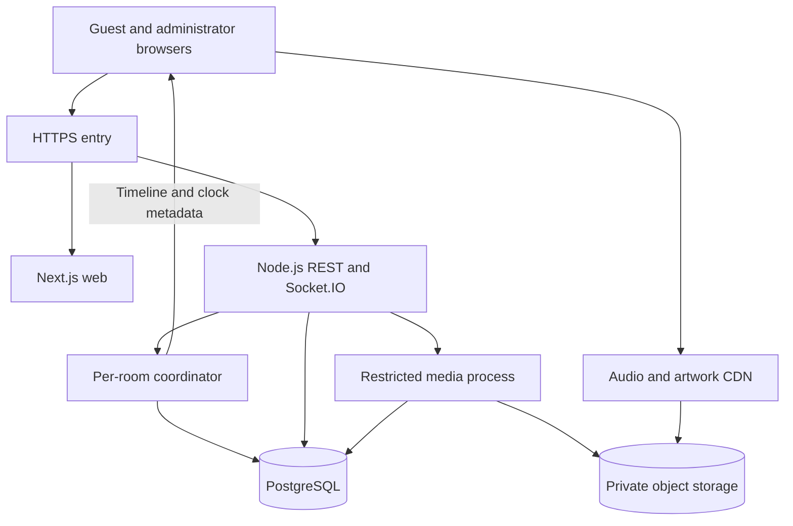

# Architecture

Status: approved Phase 0 target architecture. Only the Phase 1 foundation exists unless PROGRESS.md states otherwise.

## Product and boundaries

AllPlay lets temporary guests create and join private-by-link music rooms. A Host and up to three Officers control a shared timeline; each device downloads the same administrator-owned/licensed audio asset and renders it locally. Public Room IDs are discovery identifiers, never ownership credentials.

- `apps/web` owns presentation and local device state.
- `apps/server` owns sessions, validation, authorization, room mutations and scheduling.
- `packages/shared` owns public schemas/contracts, never secrets or database clients.
- `packages/database` will own Prisma and persistence from Phase 5.
- `packages/audio-sync` owns browser-independent clock/timeline math and the later audio engine boundary, without importing server modules.
- Audio travels over HTTPS, not through Socket.IO.

Use npm workspaces, strict TypeScript and explicit package exports. Shared packages currently build to `dist` before consumers run. Avoid microservices, Redis and complex monorepo orchestration in the single-server MVP.

## Runtime

Production routing targets one origin: pages to Next.js, `/api/v1/*` and `/socket.io/*` to a persistent backend. Local Next.js rewrites mirror this routing. Audio uses a separate CDN with controlled CORS. The frontend's hosting must not be expected to run a persistent socket server in request-limited serverless functions.

The backend uses transport adapters, Zod validation, session lookup, authorization, domain services and repositories. A room coordinator serializes commands. Database transactions and revision checks guard persistence; a process-local lock alone is insufficient for future scaling.

## State and recovery

Persistent: sessions, rooms, membership, queue, playback transitions, receipts, catalog and audit events. Ephemeral: socket IDs, heartbeats, ready sets, clock samples and scheduling timers. Playback position is derived from an anchor, not written continuously.

Phases 3–4 use memory repositories and lose rooms on restart. Phase 5 introduces durable repositories. Following a later production restart, restore rooms paused/recovering, generate a new server clock epoch and reschedule only through an authorized command.

## Defaults approved with the blueprint

| Setting                         | Initial value               |
| ------------------------------- | --------------------------- |
| Capacity                        | 20 devices including Host   |
| Officers                        | 3                           |
| Public code                     | 12 CSPRNG Base32 characters |
| Lifetime                        | 24 hours                    |
| Empty room / Host absence grace | 10 minutes                  |
| Reconnect seat reservation      | 2 minutes                   |
| Queue size                      | 100 items                   |
| Audio duration / upload size    | 5 minutes / 50 MiB          |
| Artwork size                    | 5 MiB                       |

Host absence does not trigger ownership transfer. Officers may act during the absence grace, after which the room closes. One active player connection per membership avoids duplicate audio across tabs. Losing a guest credential can mean losing Host ownership; a Room ID is not recovery proof.

## Scaling and limitations

The first load-test scenario is 50 rooms with 20 connections each, not a supported-capacity claim. CDN traffic, database pool limits, event-loop delay and cleanup must be measured. Future multi-server operation needs room ownership/fencing as well as a Socket.IO Redis adapter.

The five-minute audio limit bounds decoded memory but does not guarantee low-memory mobile operation. Bluetooth, background suspension and network asymmetry limit acoustic accuracy. See AUDIO_SYNC_DESIGN.md.
