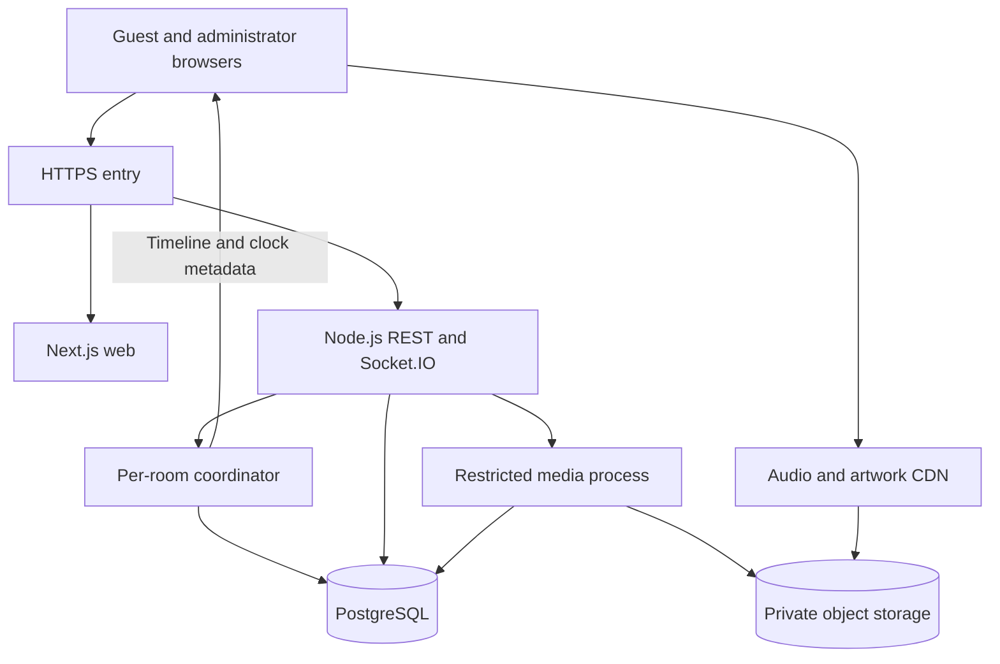

# Architecture

Status: Phases 1–3 implement infrastructure, UI foundation and the in-memory Room System. Database persistence, Officer management, music and synchronization remain target design. See PROGRESS.md for actual verification.

### Phase 3 runtime decisions

REST guest bootstrap issues a secure opaque cookie and CSRF token; REST create/join establish membership. Socket.IO authenticates that cookie, room membership and CSRF token, then attaches one active socket per identity. New tabs take over instead of doubling participants. Full snapshots with revisions cover all presence changes and reconnect recovery. No room secrets are put into URLs, JSON responses or browser storage.

`modules/rooms/room-service.ts` owns synchronous domain mutations and injectable-time expiry; HTTP and Socket.IO are transport adapters. `coordinator.ts` loads a validated snapshot and commits through a compare-and-set store, publishing effects only after success. Local memory mode supports up to 500 rooms and 5,000 sessions and loses state on restart. Redis mode shares state, rate counters and Socket.IO broadcasts across instances, with tighter demo caps of 5 rooms, 100 sessions and a 512 KiB snapshot. Cleanup is lazy on operations and active-socket refreshes (1 second locally, 30 seconds in cloud mode). Persisted 90-second connection leases handle vanished cloud instances. See VERCEL_DEPLOYMENT.md for limits and outstanding live verification.

## Product and boundaries

AllPlay lets temporary guests create and join private-by-link music rooms. A Host and up to three Officers control a shared timeline; each device downloads the same administrator-owned/licensed audio asset and renders it locally. Public Room IDs are discovery identifiers, never ownership credentials.

- `frontend` owns presentation and local device state.
- `backend` owns sessions, validation, authorization, room mutations and scheduling.
- `shared/contracts` owns public schemas/contracts, never secrets or database clients.
- `backend/database` will own Prisma and persistence from Phase 5.
- `shared/audio-sync` owns browser-independent clock/timeline math and the later audio engine boundary, without importing server modules.
- Audio travels over HTTPS, not through Socket.IO.

Use npm workspaces, strict TypeScript and explicit package exports. Shared packages build to `dist` before consumers run. Redis is optional locally but required for the approved Vercel multi-instance deployment. No additional orchestration is introduced.

## Runtime

Production routing targets one origin: pages to Next.js, `/api/v1/*` and `/socket.io/*` to the backend. Vercel Services Beta provides this routing; its WebSockets Beta requires reconnect handling at function duration limits. State lives outside individual function instances. Local Next.js rewrites mirror the routing. Future audio uses a separate CDN with controlled CORS.

The backend uses transport adapters, Zod validation, session lookup, authorization, domain services and repositories. A room coordinator serializes commands. Database transactions and revision checks guard persistence; a process-local lock alone is insufficient for future scaling.

## State and recovery

Persistent: sessions, rooms, membership, queue, playback transitions, receipts, catalog and audit events. Ephemeral: socket IDs, heartbeats, ready sets, clock samples and scheduling timers. Playback position is derived from an anchor, not written continuously.

Phases 3–4 use memory repositories and lose rooms on restart. Phase 5 introduces durable repositories. Following a later production restart, restore rooms paused/recovering, generate a new server clock epoch and reschedule only through an authorized command.

## Defaults approved with the blueprint

| Setting                         | Initial value               |
| ------------------------------- | --------------------------- |
| Capacity                        | 20 devices including Host   |
| Officers                        | 3                           |
| Public code                     | 12 CSPRNG Base32 characters |
| Lifetime                        | 24 hours                    |
| Empty room / Host absence grace | 10 minutes                  |
| Reconnect seat reservation      | 2 minutes                   |
| Queue size                      | 100 items                   |
| Audio duration / upload size    | 5 minutes / 50 MiB          |
| Artwork size                    | 5 MiB                       |

Host absence does not trigger ownership transfer. Officers may act during the absence grace, after which the room closes. One active player connection per membership avoids duplicate audio across tabs. Losing a guest credential can mean losing Host ownership; a Room ID is not recovery proof.

## Scaling and limitations

The original future load-test scenario is 50 rooms with 20 connections each, not a supported-capacity claim or the free demo limit. CDN traffic, database pool limits, event-loop delay and cleanup must be measured. Current Redis mode uses global snapshot CAS and socket-ID fencing alongside the adapter. This is not an efficient large-scale room store.

The five-minute audio limit bounds decoded memory but does not guarantee low-memory mobile operation. Bluetooth, background suspension and network asymmetry limit acoustic accuracy. See AUDIO_SYNC_DESIGN.md.
